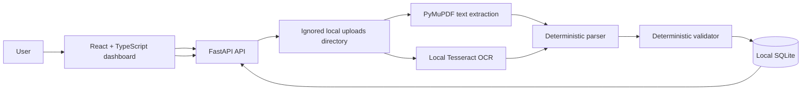

# Invoice Intelligence

Invoice Intelligence is a local-first invoice document processing application. Upload a PDF or image, extract selectable PDF text or run local OCR, parse common invoice fields with deterministic Python rules, validate the result, and review the saved record in a React dashboard.

It processes user-provided documents. It does not bundle example invoices, call AI/LLM services, or send invoice contents to a cloud OCR API.

## Features

- Upload PDF, PNG, JPG, and JPEG documents up to 10 MiB.
- Extract text from normal PDFs with PyMuPDF.
- Use local Tesseract OCR for scanned PDF pages and uploaded images.
- Parse invoice number, date, vendor, subtotal, tax, total, and currency with deterministic rules.
- Validate required fields, supported currencies, dates, and financial consistency.
- Save structured fields and validation results in local SQLite.
- Review counts, recent history, invoice details, validation checks, and warnings in a responsive dashboard.
- Delete an invoice record and its associated uploaded file.

## Architecture



The parser and validator run in the backend. Raw extracted text is returned by the PDF text endpoint for inspection but is not stored in SQLite. Uploaded binary documents stay in the ignored `backend/uploads/` directory until their record is deleted.

## Technology stack

- **Backend:** Python, FastAPI, Pydantic, Uvicorn, PyMuPDF, SQLite
- **OCR:** Tesseract OCR, installed locally
- **Frontend:** React, TypeScript, Vite
- **Tests:** pytest, FastAPI TestClient, httpx

## Project structure

```text
backend/
  app/
    main.py                     FastAPI routes
    database.py                 SQLite connection and schema
    schemas.py                  API response models
    repositories/invoices.py    SQLite persistence
    services/
      uploads.py                Upload validation and file lifecycle
      document_extractor.py     PDF/image extraction selection
      ocr.py                    Local Tesseract adapter
      invoice_parser.py         Deterministic field parsing
      invoice_validator.py      Deterministic validation
  tests/                        Backend tests with synthetic documents
  requirements.txt
frontend/
  src/App.tsx                   Dashboard and invoice views
  src/api.ts                    FastAPI client
  src/types.ts                  API response types
  src/styles.css                Responsive styling
  .env.example                  Vite API URL example
.env.example                    Optional backend Tesseract path example
.gitignore
README.md
```

At runtime, the backend creates `backend/uploads/` and `backend/invoice_intelligence.sqlite3` as needed. They are ignored by Git.

## Local setup (Windows)

### 1. Install Tesseract for OCR

Download the current 64-bit Windows installer linked from the [UB Mannheim Tesseract page](https://github.com/UB-Mannheim/tesseract/wiki). During setup, ensure English (`eng`) language data is selected. Use the suggested installation directory or a new empty directory; the installer warns that its uninstaller removes its installation directory.

Open a new PowerShell window and verify Tesseract and its language data:

```powershell
tesseract --version
tesseract --list-langs
```

The language list must include `eng`. If `tesseract` is not on `PATH`, the application checks the standard path `C:\Program Files\Tesseract-OCR\tesseract.exe`. For a custom installation, set `TESSERACT_CMD` to the full executable path before starting the backend:

```powershell
$env:TESSERACT_CMD = 'C:\Program Files\Tesseract-OCR\tesseract.exe'
```

The optional value is also shown in the root `.env.example`. The backend reads process environment variables; it does not automatically load a root `.env` file. When `TESSERACT_CMD` is unset, it checks the standard Windows path and then falls back to resolving `tesseract` through `PATH`. Text-based PDFs do not require Tesseract.

For Ubuntu/Debian, install `tesseract-ocr` using the system package manager. On macOS, install Tesseract with Homebrew. In either case, make the `tesseract` executable and English trained data available to the backend process.

### 2. Set up the backend

From the repository root in PowerShell:

```powershell
py -m venv .venv
.\.venv\Scripts\Activate.ps1
python -m pip install -r backend\requirements.txt
```

If activation is blocked, use `.\.venv\Scripts\python.exe` instead of `python`. The Windows standard Tesseract path is detected automatically; set `$env:TESSERACT_CMD` first if you installed it elsewhere.

### 3. Set up the frontend

In a second terminal:

```powershell
cd frontend
Copy-Item .env.example .env
npm install
```

`VITE_API_BASE_URL` defaults to `http://localhost:8000`. Change it in `frontend/.env` if the API runs at another local address.

### 4. Run the application

Start the API from the repository root:

```powershell
python -m uvicorn app.main:app --app-dir backend --reload
```

Start the frontend from `frontend/` in the other terminal:

```powershell
npm run dev
```

Open the Vite URL printed in the terminal, usually `http://localhost:5173`. The health endpoint is `http://127.0.0.1:8000/api/health`.

## OCR and document processing

`POST /api/invoices/{upload_id}/process` chooses the extraction path automatically:

1. For a PDF, PyMuPDF extracts selectable text page by page.
2. A page with fewer than 20 letters or digits is treated as likely scanned. The backend renders that page locally at 144 DPI and sends the image bytes to Tesseract.
3. PNG/JPG/JPEG uploads are validated and sent directly to Tesseract.
4. Extracted text goes to the existing deterministic parser and validator; only structured fields and validation results are saved in SQLite.

Tesseract runs locally with the English model and page segmentation mode 6. If it is needed but unavailable, the API returns a safe setup error. OCR quality depends on scan resolution, contrast, rotation, and language. Review extracted values before relying on them.

## Parsing and validation

The parser uses labels and regular expressions; it is not AI and does not understand every invoice layout. It recognizes common invoice number/date, subtotal, tax/GST/VAT, and total/amount due labels, plus INR, USD, EUR, GBP, and common currency symbols. Vendor detection uses an explicit vendor/supplier/seller/from label when present, otherwise it uses the first meaningful header line. These heuristics can miss or misidentify fields.

Validation checks required fields, date format, obviously future dates, supported currencies, non-negative amounts, and whether subtotal plus tax equals total within a `0.01` Decimal tolerance. Errors make an invoice invalid; warnings indicate suspicious or unsupported information that merits review.

## API overview

| Method | Endpoint | Purpose |
| --- | --- | --- |
| `GET` | `/api/health` | Backend health check |
| `POST` | `/api/invoices/upload` | Upload a PDF, PNG, JPG, or JPEG (10 MiB maximum) |
| `GET` | `/api/invoices/{upload_id}/text` | Extract selectable text from a PDF |
| `GET` | `/api/invoices/{upload_id}/parsed` | Parse an uploaded PDF without saving it to history |
| `POST` | `/api/invoices/{upload_id}/validate` | Validate an uploaded PDF without saving it to history |
| `POST` | `/api/invoices/{upload_id}/process` | Extract (including OCR), parse, validate, and save a supported document |
| `GET` | `/api/invoices` | List saved invoices newest first |
| `GET` | `/api/invoices/{invoice_id}` | Get one saved invoice and its validation details |
| `DELETE` | `/api/invoices/{invoice_id}` | Delete the saved record and its associated upload when safe |

### Example workflow

Upload a document:

```powershell
curl.exe -X POST http://127.0.0.1:8000/api/invoices/upload -F "file=@C:\path\to\invoice.pdf"
```

Use the returned `upload_id` to process it, then inspect history:

```powershell
curl.exe -X POST http://127.0.0.1:8000/api/invoices/UPLOAD_ID/process
curl.exe http://127.0.0.1:8000/api/invoices
```

Processing the same upload twice returns HTTP 409. Deleting an invoice removes its record, upload metadata, and associated file if that file is present and not shared with another record. Deleting a missing file is handled safely.

## Dashboard statistics

The overview shows total, valid, and invalid invoice counts computed from API history, plus recent records. It does not show one grand monetary total: invoices can use different currencies, and adding them together would be misleading. The invoice table and detail view show each total with its own currency.

## Tests and production build

From the repository root:

```powershell
python -m pytest -q
```

For the frontend production build:

```powershell
cd frontend
npm run build
```

The tests use generated synthetic documents and temporary SQLite databases. No private invoice samples are required.

## Security and local data

- Uploads are limited to 10 MiB and checked against PDF/PNG/JPEG file signatures.
- Stored filenames are generated IDs; original names are display metadata only.
- API errors do not include paths, stack traces, OCR stderr, or document text.
- Uploaded files and SQLite databases, environment files, virtual environments, caches, and build output are excluded by `.gitignore`.
- Deleting an invoice only removes the upload associated with that record; arbitrary paths are never accepted by the delete endpoint.

## Deployment preparation and constraints

The current backend is designed for local use and is **not a drop-in serverless backend**. SQLite and uploaded documents live on local disk, and OCR launches a local Tesseract subprocess. Ephemeral serverless filesystems can lose the database/uploads between instances, and many serverless runtimes do not include or support the required OCR binary.

For a future hosted deployment, use a persistent service/container or VM with Tesseract and durable storage mounted for both SQLite and uploads. Configure `TESSERACT_CMD` (if needed), upload limits, CORS origins, backups, and access controls for the host. A static frontend could be hosted separately (including on Vercel) only if it points to a separately hosted backend with persistent storage and Tesseract. This repository does not deploy or configure a hosted service.

## Limitations and future improvements

- Deterministic parsing is layout-sensitive and may require user review.
- OCR is English-only by default and does not report confidence scores.
- There is no authentication, multi-user isolation, or remote database.
- The current SQLite schema and local file storage target one local application instance, not concurrent multi-instance deployment.
- Future work could add richer currency-aware statistics, OCR language selection/confidence review, data export, user accounts, and a production storage/database design.
